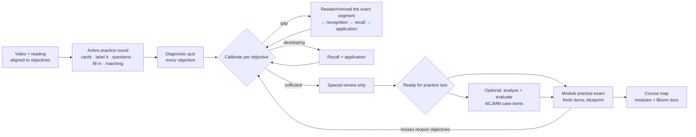

# Adaptive learning for Cueory

Task 4b adds an explainable practice queue and a short unit check. Review mode already schedules spaced practice, and the existing adaptive and level-test rules already choose question difficulty. Keep those rules available while the new engine is tested. Tell students why they are seeing an item, such as “due for review” or “you missed this concept recently.” The engine estimates recall of specific material and never shows an exam score or a chance of passing (D-36).

## What the device remembers

- Per card, keep its deck-scoped ID and content revision, when it was last answered, a small measure of memory strength called a half-life, and a count of successful reviews on separate days. Use only the right or wrong result. The engine needs neither the student's answer nor the question text.
- Per concept, keep correct and missed counts, the latest result and its date. Question difficulty still follows the existing rule of moving up after two correct at the current level and down after a miss. Keep item skill and concept evidence separate. Knowing one card teaches us little about the rest of a concept.
- Use compact on-device progress. An absent or invalid record starts fresh for that item. A content revision invalidates old card evidence. Local persistence is a separate change and must use the existing progress export and deletion boundary before shipping.

## How answers change predicted recall

Use [Settles and Meeder's half-life model](https://aclanthology.org/P16-1174/), where recall is estimated as two raised to the power of minus elapsed time divided by half-life. After one half-life passes, the estimate is one half. Cueory uses the equation with fixed, readable rules rather than fitting the paper's regression. A card starts with a three-day half-life. A correct answer on a later calendar day increases it by 60%. A miss halves it and resets its spaced-success count. Repeating a correct answer the same day refreshes the last answer time without increasing the strength or earning additional spaced credit. Bound the half-life between one and 120 days. These are unverified Cueory starting values.

## When a card comes back

Space reviews using the relationship between delay and retention tested by [Cepeda and colleagues](https://doi.org/10.1111/j.1467-9280.2008.02209.x). Use the first whole local-calendar interval that brings predicted recall to or below 80%, with a one-day minimum and a 14-day maximum in this pilot. A missed card is due tomorrow. Keep the existing 1, 3, 7 and 14 day Review ladder as the baseline for comparison (Task 4 and D-87); keep account review rows on that ladder. The 80% target and caps are unverified product defaults.

If a future exam is set, bring long intervals forward to at most the day before it, while leaving at least one day between scheduled reviews. If no day remains between the answer and the exam, keep the ordinary due date rather than scheduling an extra exam session. After that date, normal intervals resume. Enforce the same practice-session limit near the exam and leave work visible if too many cards are due. A calendar-day input keeps time-zone changes and daylight-saving shifts out of the date rules. The design does not assume a student's exam timetable records when they are available to study.

## Which item comes next

Take first the oldest due review, then studied concepts whose smoothed success rate is below 80%, with a recent miss ahead of ties. Introduce unseen concepts before offering unused cards in concepts at or above the threshold. At the requested difficulty, prefer untried items and use the existing easier-first tie rule when a level is absent. Starting with success and failure counts for concept ranking is inspired by [Pavlik, Cen and Koedinger's Performance Factors Analysis](https://pact.cs.cmu.edu/koedinger/pubs/AIED%202009%20final%20Pavlik%20Cen%20Keodinger%20corrected.pdf). Cueory uses those counts in a transparent ordering, with no fitted coefficients. The ordering and a 20-item session cap are unverified defaults.

The browser session keeps its last accepted instant and local day if the device clock or time zone goes backward. Answers still count in that session. The rollback does not earn credit for an extra day of practice.

Pass in today's calendar day and an explicit clock reading. The caller also supplies randomness for genuine ties. Exclude the previous item before ranking, and end with a short explanation if no eligible item remains. An item can reappear after another item. Cap the number of selections, including revisits. Keep the queue local to the current session and avoid pulling in future reviews just to fill it.

## What a unit check can tell a student

Keep [the existing level-test rule](../../src/islands/leveltest.ts). Give each concept a first question at level 2, or an available neighboring level, before any follow-up. A correct first answer can open one unused level 3 question. A miss, no remaining eligible question, or a second answer finishes that concept. Stop when there is no eligible question left. Show the actual result, the difficulty tested, and open gaps such as “one question answered” or “harder question unavailable.”

For quantifying uncertainty in the small sample, use [Wilson's score interval](https://doi.org/10.1080/01621459.1927.10502953) as a descriptive range alongside the number right and number asked. Questions vary in difficulty and the second depends on the first, so the interval's nominal coverage is unverified for this design. Do not label it a measurement of the student's ability or show it as a percentage on their study screen. Surface the existing status words with an icon and a short evidence note. Keep unit-check evidence distinct from spaced mastery.

## What mastered means

In spaced practice, call a card mastered only after two correct reviews on separate days after introduction, with a current recall estimate of at least 80%. A miss resets the streak and falling recall can put a card back into review. A concept qualifies only with that evidence across at least two distinct cards, with every currently studied card for that concept meeting the threshold. If a deck has too little evidence, show that explicitly. This is Cueory's unverified operational definition, informed by the spaced retrieval model above and distinct from Learn mode's current-session meaning of “mastered.”

## Validation and release boundaries

- Unit and seeded property tests cover clock boundaries, missing items, very small decks, no immediate repeats, the session cap and the effect of a correct answer on the next interval.
- A reproducible simulation compares the engine with the existing review ladder over thousands of synthetic runs. Use simulated recall curves independent of the engine, and a separate fixed-gap recall probe. Report recall, work per calendar day, and time to the mastery rule including the share that never reaches it. See the initial synthetic results below. Simulation is a check of behavior under assumptions and says nothing about actual student outcomes.
- A hidden, non-indexed preview on the locked staging site may use the existing labeled sample deck. Keep it behind the same preview pruning rules as other draft routes. The first study-mode connection is default-off and must pass the built-answer-keys guard. The preview may use public flashcard backs. Reviewed bank items still depend on server-side checking and return only the allowed result to the engine, per D-33 and D-86.
- The engine imports no browser or network code. No database change or new dependency is needed for the standalone pilot. Account sync and using the reviewed bank stay separate from the pilot.

## Initial simulation

2,000 fixed synthetic student seeds per scheduler, each with 24 cards over 45 calendar days. The schedules share the same simulated attendance, daily cap and response draws. Their simulated memory strengthens according to a separate model that uses the time since the previous answer. The recall column is the mean probability on a shared follow-up day, seven days after the 45-day study period ends. For each card, the calculation includes all the time since that card's last practice. Workload includes first answers and reviews, averaged over every calendar day.

| Scheduler | Modeled recall at the 7-day follow-up | Answers per day | Days to first whole-deck mastery, among those who reached it | Never observed at whole-deck mastery by day 45 |
| --- | ---: | ---: | ---: | ---: |
| Adaptive | 90.11% | 5.70 | 24.13 | 27.90% |
| Existing ladder | 83.11% | 4.63 | No observations | 100.00% |

Both groups use the same Cueory mastery rule for this measurement. Requiring all cards to meet the 80% recall threshold at once favors schedules that review more frequently. The table illustrates that trade-off and cannot establish better learning or predict an exam result. These runs use no exam date; the calendar and exam rules have separate tests.

To reproduce on a checkout of staging, use the installed dependencies:

```sh
mkdir -p work/adaptive
./node_modules/.bin/esbuild scripts/simulate-adaptive-learning.ts --bundle --platform=node --outfile=work/adaptive/simulation.cjs
node work/adaptive/simulation.cjs
```

## Module path and course map

Tracked in [#1281](https://github.com/lilchristxan/Cueory/issues/1281). The defaults below are unverified until the Phase 8 simulation checks them.
Christian's direction (Nov 28, 2026): one system that treats a module's **video and reading together as the input**, runs **active practice** (flashcards, label it / image occlusion, learning questions, fill in the blank, matching), uses the **quiz afterward as the diagnostic**, then **calibrates adaptive practice** until the student is above sufficient understanding to take a practice test. From there the student can **go further into analysis and evaluation** (Bloom's) and then **own the module's practice exam**. Finally, connect each module to the whole course to show course-level **understanding, analysis, evaluation and real-world application**.

This builds on `docs/design/adaptive-learning.md` (#1256, #1257, #1258, #1266, #1275, #1280). Keep that engine. It handles **retention** per card. This brief adds the layer above it: **understanding per learning objective and per Bloom tier**, the module path, and the course map.



### Keep these rules

- D-36: no exam score prediction and no chance of passing. Show status words, an icon, evidence counts, and the actual number right on tests the student took.
- Module "needs" are recommendations, not locks (Nov 3). The practice exam is always open. It is *recommended* once the gate is met.
- On-device progress first, through the existing export and reset boundary. Any database change or signed-in sync needs a separate approved design.
- Reviewed bank items are still checked on the server, and only the allowed result reaches the engine (D-33, D-86).
- Pure TypeScript engine with no browser or network imports. Every new UI goes behind a default-off switch or a locked preview route until Christian looks at it.
- Pharmacology is embedded in each module, never a separate one. Clinical application goes through the nursing process / NCJMM.
- Study pages use the approved focused-card designs (#1255, #1260), tachyyy mode (#1269) and the read-aloud button. A tachyyy timeout counts as a miss.

### 1. Content model (the input)

- A module has lessons. Each lesson has a **video** (YouTube embed) and a **reading**. Both are cut into **anchors**: a video time range or a reading section id.
- Each lesson lists **learning objectives (LOs)**. An LO has an id, concept id(s), a Bloom tier (remember / understand / apply / analyze / evaluate) and the anchors that teach it.
- **Every** study item (flashcard, label-it set or region, learning question, fill-in-the-blank, matching set, diagnostic item, exam item) carries `lo`, `bloom`, `level` (1–3, same as the existing difficulty rule) and `anchor`.
- Extend the lesson board file (#1268) with `lo`, `bloom` and `anchor` columns. The video's images already become label-it sets, and its transcript already becomes the other rows.
- Add a validator that fails the build when a published LO has no anchor or no item for the diagnostic, or when an item points to a missing LO. It should warn when an LO has fewer than one item per activity type, or fewer than 3 unused items for the practice exam.

### 2. Learner model (per LO × Bloom tier)

- Evidence is weighted by how much the task proves. Defaults (unverified, tune by simulation): matching and flashcard flips 0.5, label it and fill in the blank 0.75, learning questions and diagnostic items 1.0, practice exam items 1.25. Using a cue halves the credit. A timeout counts as a miss.
- Each LO tier keeps a Beta(1,1) prior updated with the weighted correct and missed counts. Report the posterior mean and its 10th-percentile lower bound. Never show either to the student as a percentage.
- Status words come from the lower bound plus a minimum amount of evidence: not started → gap → developing → **sufficient** → strong. Default for **sufficient**: lower bound ≥ 0.70, with ≥ 3 weighted evidence including at least one *first-try* correct on an item the student had not seen before.
- Retention stays with the existing half-life engine. When an LO's cards fall below 80% recall, the LO drops one status until it is reviewed.
- Transfer: when a higher tier is correct (apply), lower tiers of the same LO get 0.5 credit. A miss at a higher tier gives lower tiers nothing.

### 3. Module path

1. **Input.** Video + reading, each with its anchors. Mark a lesson viewed once the student has watched most of the video or scrolled the reading; it is never a lock.
2. **Active practice round.** One short pass per activity type across the lesson's LOs. Default order: flashcards → label it → learning questions → fill in the blank (dropdown blanks) → matching. Cap around 15 minutes. This collects low-weight evidence.
3. **Diagnostic quiz.** One understand- or apply-tier item per LO, then follow the existing level-test rule (level 2 first, a correct answer opens one level 3). It sets each LO's starting status at full weight.
4. **Calibrate and adapt.**
   - A **gap** first links to the exact anchor ("rewatch 3:12–4:05" or "reread: compensation"), then climbs from recognition (matching or cards) to recall (fill in, label it) to application (questions).
   - **Developing** gets recall and application. **Sufficient** gets spaced review only.
   - Aim for about 70–85% success by choosing the level per LO with the existing up-after-two, down-after-miss rule.
   - Interleave: no more than 2 items from the same LO in a row. Keep the 20-item session cap. Always tell the student *why* they are seeing an item ("you missed this on the diagnostic", "due for review").
5. **Readiness gate.** "Ready for the practice test" when every LO is **sufficient** at understand and apply.
6. **Go further (optional).** Analyze and evaluate items built as NCJMM case items: recognize cues, analyze cues, prioritize hypotheses, generate solutions, take action, evaluate outcomes. Use NGN-style formats where we have them (matrix, extended multiple response, highlight, bowtie). These tiers appear only after the gate, on their own track.
7. **Module practice exam.** Assembled from a blueprint that weights LOs by importance and covers every Bloom tier the student unlocked. Use only fresh items the student has not seen. Results show the number right and the status per LO. Each missed LO reopens step 4. "Owning" the module means strong at every tier, including analyze and evaluate, after the practice exam.
8. **Spaced review** continues through the existing engine.

### 4. Course map

- Aggregate every module's LOs into a **modules × dimensions** grid. The dimensions are **understanding** (remember and understand), **application** (apply), **analysis**, **evaluation**, and **real-world application** (cross-module NCJMM case studies that pull LOs from two or more modules).
- Each cell shows a status word, an icon and the evidence count. Retention decay counts, so a module studied weeks ago can fade.
- Course readiness for a final or exit exam: every module at sufficient, plus a cumulative case-study set. Weight modules by the course blueprint (for Med-Surg I, the curriculum map's weights).

### 5. Phases (one PR each, to staging, behind switches)

1. Content model, lesson board columns and validator. Tag one sample module (use the existing labeled sample deck plus one real Med-Surg I lesson if it is ready).
2. Learner model as a pure module, with unit and seeded property tests.
3. Diagnostic blueprint, calibration and remediation planner, and the readiness gate.
4. Evidence adapters from cards, label it, learn, fill in the blank and matching. Build matching as a focused screen if it does not exist yet, in the approved study-page style.
5. Module path UI on a locked preview route `/preview/module-path`.
6. Analyze and evaluate items and the practice exam assembler (fresh items only).
7. Course map aggregation, plus the preview UI as a visual grid. Christian is visual, so make the map the first thing he sees.
8. Extend the simulation: synthetic students run the whole module path. Report time to readiness, the share wrongly marked ready (when their simulated true skill is below the threshold), and items per day. Tune the weights and thresholds from it, and record them in the design doc.

Update `docs/design/adaptive-learning.md` with a "Module path and course map" section in the first PR, and log each PR there. Use the defaults above without waiting. Put only real blockers under **Needs Christian**, phrased as yes/no questions.

## Progress log

- [#1256](https://github.com/lilchristxan/Cueory/pull/1256) — design draft with the model, release boundaries and research references.
- [#1257](https://github.com/lilchristxan/Cueory/pull/1257) — shipped to staging with the pure engine, module tests and fixed-seed simulation.
- [#1258](https://github.com/lilchristxan/Cueory/pull/1258) — shipped the on-device progress format and migration to staging. Browser saving remains disconnected.
- [#1266](https://github.com/lilchristxan/Cueory/pull/1266) — shipped the locked sample preview, backwards-clock recovery and measured route budget to staging.
- [#1275](https://github.com/lilchristxan/Cueory/pull/1275) — shipped the Learn connection to staging with the switch off. The existing see, choose and type flow stays active. Explicit opt-in is limited to the labeled study-skills deck in builds that allow samples.

## Staging trial approval

Christian approved trying the 20-item session cap and the proposed spaced mastery rule on staging. The hidden preview already uses both. Study progress and the exam date stay in the open page and clear on reload.

To try the schedule, open `/preview/adaptive-learning` on locked staging. Leave the exam date blank for the ordinary schedule, or enter one as `YYYY-MM-DD`. Start the sample and answer the cards. When the session shows its next scheduled review, choose **jump to that review day** to see which card comes back. That date jump is a preview control.

## Needs Christian

- Should the exam plan include an optional lighter day before the exam? The pilot uses its usual session cap.
- Before connecting device storage, decide how saved adaptive progress should appear in download and reset, and confirm how the privacy page should describe it. The storage draft defines the format and migration only.
- If signed-in sync becomes necessary, decide what state should be shared between devices and whether the existing review rows can represent it. A new database field or policy needs a separate approved design.
- Decide whether to turn on the Learn switch for the labeled sample on locked staging. The existing Learn experience remains the default.
